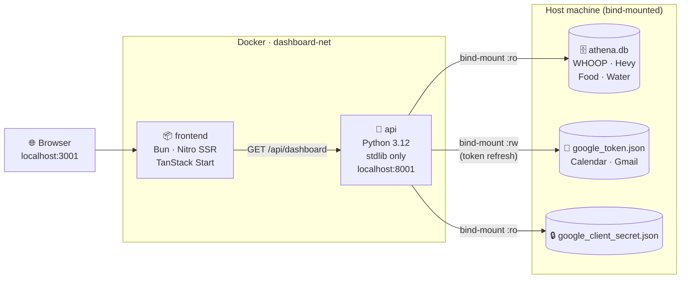

<div align="center">

# 🧠 Athena — Personal AI OS Dashboard

[](https://docs.docker.com/get-docker/)
[](https://bun.sh)
[](https://python.org)
[](https://tanstack.com/start)
[](LICENSE)

**Your life in one tab — running on your own machine, on your own data.**

Real-time health from WHOOP, workouts from Hevy, email triage from Gmail, and calendar events from Google — aggregated by your personal AI agents and served as a live command centre.

[**🚀 Deploy Now**](#-deployment) · [**🛠 Local Dev**](#-local-development) · [**📡 Data Sources**](#-data-sources)

</div>

---

## 📋 Table of Contents

- [Overview](#-overview)
- [Architecture](#-architecture)
- [Prerequisites](#-prerequisites)
- [Deployment](#-deployment)
- [Configuration](#️-configuration)
- [Data Sources](#-data-sources)
- [Local Development](#-local-development)
- [Project Structure](#-project-structure)
- [Roadmap](#-roadmap)

---

## 🎯 Overview

Athena pulls live data from agents already running on your machine and presents it without any third-party cloud dependency:

| Card         | Data                                                      | Source                                 |
| ------------ | --------------------------------------------------------- | -------------------------------------- |
| 🫀 Recovery  | Score, HRV, RHR, SpO₂                                     | WHOOP → Athena agent                   |
| 😴 Sleep     | Duration, performance %, disturbances                     | WHOOP → Athena agent                   |
| ⚡ Strain    | Day strain, avg/max HR                                    | WHOOP → Athena agent                   |
| 🏋️ Workout   | Last session, exercises, sets × reps × lbs                | Hevy → Athena agent                    |
| 💧 Nutrition | Water, calories, protein                                  | Athena agent (self-reported)           |
| 📅 Calendar  | Upcoming events (7 days)                                  | Google Calendar → Horus agent          |
| 📬 Email     | Unread count, actionable items (recruiter noise filtered) | Gmail → Horus agent                    |
| 💰 Finance   | Connecting soon                                           | Horus agent (purchase history pending) |

**Cross-domain insights** are computed live — recovery drops, fatigue streaks, sleep disturbance patterns — backed by 14 days of real WHOOP data rendered as a sparkline chart.

---

## 🏗 Architecture



The Python data API is **pure stdlib** — zero pip dependencies. It reads the Athena SQLite database directly and calls Google APIs using the OAuth tokens managed by the Horus agent. The frontend is server-side rendered by Nitro/Bun, not served by nginx.

---

## ✅ Prerequisites

- **Docker Engine** + Compose plugin v2
  ```bash
  sudo -S -p '' apt-get install -y docker.io docker-compose-v2
  ```
- **Athena agent** running and syncing WHOOP/Hevy data into `athena.db`
- **Horus agent** with a valid Google OAuth token (`google_token.json` with a live refresh token)

| File                        | Purpose                                                            | Must be    |
| --------------------------- | ------------------------------------------------------------------ | ---------- |
| `athena.db`                 | SQLite DB — WHOOP recovery/sleep/strain, Hevy workouts, food/water | Readable   |
| `google_token.json`         | Google OAuth — Calendar + Gmail access, auto-refreshed             | Read-write |
| `google_client_secret.json` | Google OAuth client credentials                                    | Readable   |

---

## 🚀 Deployment

### 1. Clone the repository

```bash
git clone https://github.com/themani-dev/athena-personal-ai.git
cd athena-personal-ai
```

### 2. Configure environment

```bash
cp docker/.env.example docker/.env
```

Edit `docker/.env` and set the paths to your data files:

```bash
ATHENA_DB_PATH=/path/to/agents/athena/tracking/athena.db
GOOGLE_TOKEN_PATH=/path/to/agents/horus/google_token.json
GOOGLE_SECRET_PATH=/path/to/agents/horus/google_client_secret.json
FRONTEND_PORT=3001
API_PORT=8001
```

### 3. Build and start

```bash
cd docker
sudo -S -p '' docker compose up -d
```

> **First build:** ~3 min (Bun installs 400+ packages + TanStack Start SSR compilation).
> Subsequent builds use layer cache and finish in seconds.

### 4. Open

```bash
open http://localhost:3001
# Raw API payload:
curl http://localhost:8001/api/dashboard | python3 -m json.tool
```

### Managing containers

```bash
# Logs
sudo -S -p '' docker compose logs -f api        # data API
sudo -S -p '' docker compose logs -f frontend   # SSR server

# Stop / restart
sudo -S -p '' docker compose down              # stop (data is safe — bind-mounted)
sudo -S -p '' docker compose up -d             # start again

# Rebuild after code changes
sudo -S -p '' docker compose build && sudo -S -p '' docker compose up -d

# Skip sudo permanently
sudo -S -p '' usermod -aG docker $USER && newgrp docker
```

---

## ⚙️ Configuration

All configuration lives in `docker/.env` (copy from `docker/.env.example`). **Never commit `.env`.**

| Variable             | Default      | Description                                       |
| -------------------- | ------------ | ------------------------------------------------- |
| `ATHENA_DB_PATH`     | _(required)_ | Absolute host path to `athena.db`                 |
| `GOOGLE_TOKEN_PATH`  | _(required)_ | Absolute host path to `google_token.json`         |
| `GOOGLE_SECRET_PATH` | _(required)_ | Absolute host path to `google_client_secret.json` |
| `FRONTEND_PORT`      | `3001`       | Browser-facing dashboard port                     |
| `API_PORT`           | `8001`       | Data API port                                     |

### Ports

| Port   | Service  | Notes                                             |
| ------ | -------- | ------------------------------------------------- |
| `3001` | Frontend | Browser-facing                                    |
| `8001` | API      | Debug: `curl http://localhost:8001/api/dashboard` |

---

## 📡 Data Sources

| Source                             | Provides                                                    | Refresh              |
| ---------------------------------- | ----------------------------------------------------------- | -------------------- |
| **WHOOP** (via `athena.db`)        | Recovery, HRV, RHR, SpO₂, sleep, strain                     | Athena agent cron    |
| **Hevy** (via `athena.db`)         | Workouts · exercises · sets × reps × lbs                    | Athena agent cron    |
| **Food & water** (via `athena.db`) | Self-reported nutrition log                                 | Athena agent         |
| **Google Calendar** (Horus token)  | Upcoming events — next 7 days                               | Auto on each request |
| **Gmail** (Horus token)            | Unread count + actionable emails (recruiter noise filtered) | Auto on each request |
| **Finance**                        | ⏳ Pending — wires up when Horus has purchase history       | —                    |

The Google OAuth token is **auto-refreshed** by the API — the token file is mounted read-write so refreshed tokens persist without manual intervention.

Client-side auto-refresh every **5 minutes**. Manual refresh button in the top bar.

---

## 🛠 Local Development

### Run without Docker

```bash
# Terminal 1 — data API on 127.0.0.1:5175
python3 api/dashboard.py --serve

# Terminal 2 — frontend dev server with HMR
bun install && bun run dev
# Vite proxies /api/dashboard → 127.0.0.1:5175 automatically
# Open http://localhost:3000
```

### Scripts

```bash
bun run dev       # dev server with HMR
bun run build     # production SSR build → .output/
bun run lint      # ESLint
bun run format    # Prettier
```

### Test the API standalone

```bash
python3 api/dashboard.py | python3 -m json.tool
```

---

## 📁 Project Structure

```
athena-personal-ai/
│
├── api/
│   ├── dashboard.py          # Data API — Python 3.12 stdlib, zero pip deps
│   └── requirements.txt      # Empty — stdlib is sufficient
│
├── src/
│   ├── routes/
│   │   ├── index.tsx          # Main dashboard — all cards, real data
│   │   └── __root.tsx         # App shell, error boundaries, head config
│   ├── hooks/
│   │   └── use-dashboard.ts   # React Query hook — 5-min auto-refresh
│   ├── lib/
│   │   ├── dashboard-types.ts # TypeScript types for API payload
│   │   ├── error-capture.ts   # SSR error capture utility
│   │   └── error-page.ts      # Generic 500 fallback HTML
│   ├── components/ui/         # shadcn/ui component library
│   └── styles.css             # Tailwind v4 design system + custom CSS
│
├── docker/                    # All Docker deployment files
│   ├── Dockerfile.frontend    # Multi-stage: oven/bun build → bun runtime
│   ├── Dockerfile.api         # Single-stage: python:3.12-slim
│   ├── docker-compose.yaml    # Two services + dashboard-net bridge
│   ├── .env.example           # ← copy to .env and fill paths
│   └── .dockerignore
│
├── public/
│   └── favicon.ico
│
├── package.json               # Bun workspace
├── bunfig.toml                # Bun install config
├── vite.config.ts             # Vite + TanStack Start + nitro:bun preset
└── tsconfig.json
```

---

## 🗺 Roadmap

- [ ] **Finance card** — connect `purchases.sqlite3` when Horus has purchase history
- [ ] **Ask Athena** — wire command bar to the Athena agent conversation API
- [ ] **Week view** — real weekly aggregations from 14-day WHOOP trend data
- [ ] **Systemd unit** — auto-start containers on boot
- [ ] **Push notifications** — Telegram alert when recovery drops below threshold

---

<div align="center">

Maintained by **Forge** (Personal AI OS) · Data stays on your machine, always.

</div>
