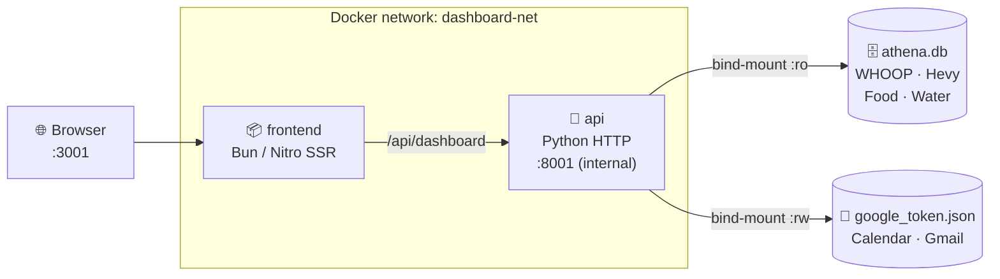

<div align="center">

# 🧠 Athena — Daily Dashboard

[](https://docs.docker.com/get-docker/)
[](https://bun.sh)
[](https://python.org)
[](https://tanstack.com/start)
[](LICENSE)
[]()

**Your entire life in one tab.** Real-time health metrics, workouts, email triage, and calendar — all from your own data, running on your own machine.

[**☁️ Live Demo**](https://athena-personal-ai.lovable.app) · [**🐛 Issues**](https://github.com/themani-dev/athena-personal-ai/issues) · [**📖 Docs**](#-quickstart)

</div>

---

## 📋 Table of Contents

- [Overview](#-overview)
- [Architecture](#-architecture)
- [Prerequisites](#-prerequisites)
- [Quickstart](#-quickstart)
- [Configuration](#%EF%B8%8F-configuration)
- [Data Sources](#-data-sources)
- [Development](#-development)
- [Deployment](#-deployment)
- [Roadmap](#-roadmap)
- [Project Structure](#-project-structure)

---

## 🎯 Overview

Athena pulls live data from **WHOOP**, **Hevy**, **Gmail**, and **Google Calendar** — all through agents already running on your machine — and presents it as a calm, intelligent command centre.

No SaaS subscriptions. No third-party cloud. Your data stays on your hardware.

| Layer | Technology | Purpose |
|---|---|---|
| Frontend | React 19 + TanStack Start (SSR) + Tailwind v4 | Dashboard UI, server-side rendered |
| Data API | Python 3.12 — **stdlib only, zero pip deps** | Reads Athena DB + Google APIs |
| Runtime | Bun 1.x + Nitro (bun preset) | SSR server — no nginx required |
| Packaging | Docker Compose — 2 services | One-command local deployment |

---

## 🏗 Architecture



The frontend makes SSR + client-side fetches to `/api/dashboard`. Inside Docker, services talk by name (`http://api:8000`) on an isolated bridge network. The Google token file is mounted read-write so the API can persist refreshed tokens automatically.

---

## ✅ Prerequisites

- [Docker Engine](https://docs.docker.com/get-docker/) + Compose plugin (v2)
- The following data files populated by the Athena / Horus agents:

| File | What it's for | Must be |
|---|---|---|
| `athena.db` | WHOOP recovery/sleep/strain, Hevy workouts, food & water log | Readable |
| `google_token.json` | Google OAuth token (Calendar + Gmail), valid refresh token | Read-write |
| `google_client_secret.json` | Google OAuth client secret | Readable |

> The Athena agent keeps `athena.db` fresh. The API handles Google token refresh automatically — no manual intervention needed.

---

## ⚡ Quickstart

```bash
cp .env.example .env          # fill in your data file paths
docker compose up -d          # build images + start containers (~2 min first run)
open http://localhost:3001    # dashboard is live
```

> **First build** takes 2–3 min (Bun install + TanStack Start SSR compilation). Layer cache makes rebuilds fast.

---

## ⚙️ Configuration

All config lives in `.env` — never commit it (only `.env.example` is safe to commit).

| Variable | Default | Description |
|---|---|---|
| `ATHENA_DB_PATH` | *(required)* | Absolute host path to `athena.db` |
| `GOOGLE_TOKEN_PATH` | *(required)* | Absolute host path to `google_token.json` |
| `GOOGLE_SECRET_PATH` | *(required)* | Absolute host path to `google_client_secret.json` |
| `FRONTEND_PORT` | `3001` | Host port for the dashboard UI |
| `API_PORT` | `8001` | Host port for the data API |

---

## 📡 Data Sources

| Source | Provides | Refresh cadence |
|---|---|---|
| **WHOOP** (via Athena DB) | Recovery score, HRV, RHR, SpO₂, sleep, strain | Athena agent cron |
| **Hevy** (via Athena DB) | Workout sessions · exercises · sets × reps × lbs | Athena agent cron |
| **Food & water log** (Athena DB) | Self-reported nutrition | Athena agent updates |
| **Google Calendar** (Horus token) | Upcoming events — next 7 days | Auto — every page load |
| **Gmail** (Horus token) | Unread count · actionable emails (recruiter noise filtered) | Auto — every page load |
| **Finance** | ⏳ Coming soon — wiring when Horus has purchase history | — |

Client-side auto-refresh every **5 minutes**. Manual refresh button in the top bar.

---

## 🛠 Development

### Local dev (no Docker)

```bash
# Terminal 1 — data API on :5175
python3 app/api/dashboard.py --serve

# Terminal 2 — frontend dev server on :3000
cd app && bun install && bun run dev
# Vite proxies /api/dashboard → :5175 automatically
```

### Inspect the API payload

```bash
curl -s http://localhost:8001/api/dashboard | python3 -m json.tool
```

### Container logs

```bash
docker compose logs -f api        # data API
docker compose logs -f frontend   # SSR server
```

### Rebuild after code changes

```bash
docker compose build && docker compose up -d
```

---

## 🚀 Deployment

### Start / stop

```bash
docker compose up -d      # start (or restart after config change)
docker compose down       # stop — data is safe, bind mounts are untouched
docker compose restart    # restart without rebuild
```

### Pull latest and redeploy

```bash
git pull
docker compose build --no-cache
docker compose up -d
```

### Keeping data fresh

| Data | How to keep it current |
|---|---|
| WHOOP / Hevy | Run the Athena agent on a schedule (cron or `hermes` session) |
| Google Calendar / Gmail | Automatic — API refreshes the OAuth token and writes it back |

---

## 🗺 Roadmap

- [ ] **Finance card** — wire up `purchases.sqlite3` when Horus has purchase history
- [ ] **Ask Athena chat** — connect command bar to the Athena agent conversation API
- [ ] **Week view** — real weekly aggregations from 14-day WHOOP trend data
- [ ] **Systemd service** — auto-start on boot via `docker compose` systemd unit
- [ ] **Healthcheck endpoint** — `/health` on the frontend container

---

## 📁 Project Structure

```
daily-dashboard/
├── app/                          # Application source (mirrors GitHub repo)
│   ├── api/
│   │   ├── dashboard.py          # Python data API — stdlib only, zero pip deps
│   │   └── requirements.txt      # Intentionally empty
│   ├── src/
│   │   ├── routes/index.tsx      # Main dashboard page (all cards)
│   │   ├── hooks/use-dashboard.ts # React Query hook, 5-min auto-refresh
│   │   └── lib/dashboard-types.ts # TypeScript types for API payload
│   ├── package.json
│   ├── bun.lock
│   └── vite.config.ts            # nitro preset: bun (self-hosted build)
├── Dockerfile.frontend           # Multi-stage: oven/bun build → bun runtime
├── Dockerfile.api                # Single-stage: python:3.12-slim
├── docker-compose.yaml           # Two services + dashboard-net bridge
├── .env.example                  # ← copy to .env and fill paths
├── .dockerignore
└── README.md
```

---

<div align="center">

Built with [Lovable](https://lovable.dev) · Maintained by **Forge** (Personal AI OS)

*Data stays on your machine. Always.*

</div>
