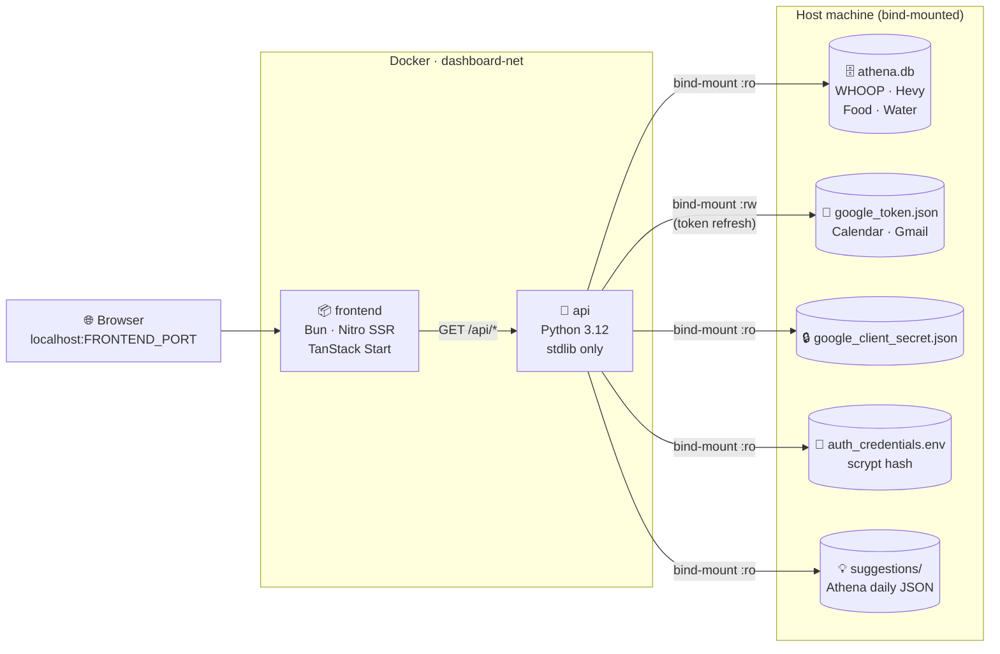

<div align="center">

# 🧠 Athena — Dashboard

[](https://docs.docker.com/get-docker/)
[](https://bun.sh)
[](https://python.org)
[](https://tanstack.com/start)

**Your health, calendar, and email — in one private tab, running on your own machine.**

Pulls live WHOOP data, Hevy workouts, Gmail triage, and Google Calendar events from agents already on your machine. No third-party cloud. All routes sit behind a login.

[**🚀 Deploy**](#-deployment) · [**🛠 Local Dev**](#-local-development) · [**⚙️ Configuration**](#%EF%B8%8F-configuration)

</div>

---

## 📋 Table of Contents

- [Overview](#-overview)
- [Architecture](#-architecture)
- [Prerequisites](#-prerequisites)
- [Deployment](#-deployment)
- [Configuration](#%EF%B8%8F-configuration)
- [Local Development](#-local-development)
- [Project Structure](#-project-structure)

---

## 🎯 Overview

A single-page personal command centre that aggregates data from your running AI agents:

| Tab / Card | Data | Source |
|---|---|---|
| 🫀 Recovery | Score, HRV, RHR, SpO₂ | WHOOP → Athena agent |
| 😴 Sleep | Duration, performance %, disturbances | WHOOP → Athena agent |
| ⚡ Strain | Day strain, avg/max HR | WHOOP → Athena agent |
| 🏋️ Workout | Last session, exercises, sets × reps × lbs | Hevy → Athena agent |
| 💧 Nutrition | Water, calories, protein | Athena agent (self-reported) |
| 📅 Calendar | Upcoming events (7 days) | Google Calendar → Horus agent |
| 📬 Email | Unread count, actionable items | Gmail → Horus agent |
| 📈 Health tab | WHOOP timeseries, physical measurements, nutrition charts | Athena agent |

**All data stays on your machine** — the API reads local files and never phones home.

---

## 🏗 Architecture



The Python data API is **pure stdlib** — zero pip dependencies. It reads the Athena SQLite database directly and calls Google APIs using tokens managed by the Horus agent. The frontend is server-side rendered by Nitro/Bun. All `/api/*` routes are proxied server-side by Nitro — credentials never touch the browser.

---

## ✅ Prerequisites

- **Docker Engine** + Compose plugin v2
  ```bash
  sudo apt-get install -y docker.io docker-compose-v2
  ```
- **Athena agent** running and syncing WHOOP/Hevy data into `athena.db`
- **Horus agent** with a valid Google OAuth token (`google_token.json` with a live refresh token)
- **Login credentials file** created before first run (see [Deployment](#-deployment))

| File | Purpose | Must be |
|---|---|---|
| `athena.db` | SQLite DB — WHOOP, Hevy, food/water logs | Readable |
| `google_token.json` | Google OAuth — Calendar + Gmail, auto-refreshed | Read-write |
| `google_client_secret.json` | Google OAuth client credentials | Readable |
| `auth_credentials.env` | Dashboard login — username + scrypt hash | Readable (`chmod 600`) |

---

## 🚀 Deployment

### 1. Create the credentials file

Run once, outside the repo. The script prompts for a username and password and stores only the salt + scrypt hash:

```bash
cd dashboard/app
python3 api/dashboard.py --create-credentials
```

Note the output path — you will set it as `AUTH_CREDENTIALS_PATH` in `.env`.

### 2. Configure environment

Create `dashboard/.env` (never commit it):

```bash
ATHENA_DB_PATH=/path/to/athena.db
GOOGLE_TOKEN_PATH=/path/to/google_token.json
GOOGLE_SECRET_PATH=/path/to/google_client_secret.json
AUTH_CREDENTIALS_PATH=/path/to/auth_credentials.env
SUGGESTIONS_DIR_PATH=/path/to/reports/dashboard-v3
FRONTEND_PORT=3001
API_PORT=8001
```

### 3. Build and start

```bash
cd dashboard/app/docker
docker compose --env-file ../../.env up -d --build
```

> **First build:** ~3 min (Bun installs packages + TanStack Start SSR compilation). Subsequent builds use layer cache and finish in seconds.

### 4. Open

```bash
open http://localhost:3001
# Verify the API directly:
curl http://localhost:8001/api/auth/status
```

### Managing containers

```bash
# Logs
docker compose --env-file ../../.env logs -f api
docker compose --env-file ../../.env logs -f frontend

# Stop (data is safe — bind-mounted)
docker compose --env-file ../../.env down

# Start again
docker compose --env-file ../../.env up -d

# Rebuild after code changes
docker compose --env-file ../../.env up -d --build
```

---

## ⚙️ Configuration

All configuration lives in `dashboard/.env`. **Never commit `.env`.**

| Variable | Default | Description |
|---|---|---|
| `ATHENA_DB_PATH` | _(required)_ | Absolute host path to `athena.db` |
| `AUTH_CREDENTIALS_PATH` | _(required)_ | Absolute host path to the credentials file (`chmod 600`) |
| `GOOGLE_TOKEN_PATH` | _(optional)_ | Absolute host path to `google_token.json` |
| `GOOGLE_SECRET_PATH` | _(optional)_ | Absolute host path to `google_client_secret.json` |
| `SUGGESTIONS_DIR_PATH` | `~/reports/dashboard-v3` | Directory where Athena writes daily suggestion JSON files |
| `FRONTEND_PORT` | `3001` | Browser-facing dashboard port |
| `API_PORT` | `8001` | Data API port |

### Session and lockout

| Variable | Default | Description |
|---|---|---|
| `SESSION_TTL_SECONDS` | `43200` (12 h) | Session cookie lifetime |
| `MAX_LOGIN_ATTEMPTS` | `5` | Failed attempts before lockout |
| `LOGIN_LOCKOUT_SECONDS` | `900` (15 min) | Lockout duration per username and IP |

### Ports

| Port | Service | Notes |
|---|---|---|
| `FRONTEND_PORT` | Frontend | Browser-facing |
| `API_PORT` | API | Debug: `curl http://localhost:<API_PORT>/api/auth/status` |

Do not expose either port directly to the internet — put them behind an authenticated tunnel or private network.

---

## 🛠 Local Development

### Run without Docker

```bash
# Terminal 1 — data API on 127.0.0.1:5175
cd dashboard/app
python3 api/dashboard.py --serve
```

```bash
# Terminal 2 — frontend dev server with HMR
cd dashboard/app
bun install
bun run dev
# Vite proxies /api/* → 127.0.0.1:5175 automatically
# Open http://localhost:3000
```

### Scripts

```bash
bun run dev      # dev server with HMR
bun run build    # production SSR build → .output/
bun run lint     # ESLint
bun run format   # Prettier
```

### Test the API standalone

```bash
python3 dashboard/app/api/dashboard.py | python3 -m json.tool
```

---

## 📁 Project Structure

```
dashboard/
│
├── app/
│   ├── api/
│   │   ├── dashboard.py          # Data API — Python 3.12 stdlib, zero pip deps
│   │   └── requirements.txt      # Empty — stdlib only
│   │
│   ├── server/api/               # Nitro server routes (proxy layer)
│   │   ├── dashboard.ts          # GET /api/dashboard → internal API
│   │   ├── login.ts              # POST /api/login → internal API
│   │   ├── logout.ts             # POST /api/logout → internal API
│   │   └── health/               # GET /api/health/* → internal API
│   │
│   ├── src/
│   │   ├── routes/
│   │   │   ├── index.tsx         # Main dashboard — all cards, real data
│   │   │   └── __root.tsx        # App shell, error boundaries, head config
│   │   ├── hooks/                # React Query hooks (dashboard, health, auth)
│   │   ├── lib/                  # TypeScript types + error utilities
│   │   ├── components/
│   │   │   ├── HealthTab.tsx     # Health tab — timeseries, measurements, nutrition
│   │   │   ├── LoginPage.tsx     # Login gate
│   │   │   └── ui/               # shadcn/ui component library
│   │   └── styles.css            # Tailwind v4 design system + custom CSS
│   │
│   └── docker/
│       ├── Dockerfile.frontend   # Multi-stage: oven/bun build → bun runtime
│       ├── Dockerfile.api        # Single-stage: python:3.12-slim
│       ├── docker-compose.yaml   # Two services + dashboard-net bridge
│       └── .dockerignore
│
└── README.md
```

---

<div align="center">

Maintained by **Forge** (Personal AI OS) · Data stays on your machine, always.

</div>
